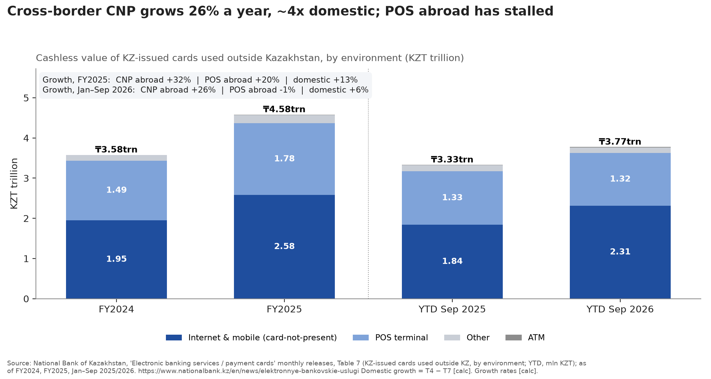
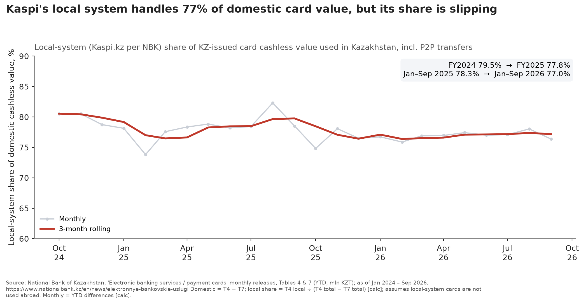

# Kazakhstan payments: where should an international card network invest in 2027–2029?

A hypothesis-driven analysis of Kazakhstan's card market, built entirely from public data (National Bank of Kazakhstan monthly payment-card releases, Kaspi.kz Form 20-F filings, and stat.gov.kz population figures). Every number carries a source URL, a table reference and an as-of date. Derived numbers are tagged **[calc]** and assumption-dependent numbers **[estimate]**.

> **Disclaimer.** Independent portfolio analysis using only public data. Not affiliated with, commissioned or endorsed by Visa, Mastercard, Kaspi.kz or the National Bank of Kazakhstan. Not investment advice. Built with AI-assisted coding (Claude Code).

## Question
> Where should an international card network (Visa / Mastercard) invest in Kazakhstan in 2027–2029 to grow, given Kaspi.kz's closed-loop dominance?

## Answer
- **The closed loop is large but has stopped gaining.** The local system (named by NBK as Kaspi.kz) handles **77.0%** of KZ-card domestic cashless value, down **1.4pp YoY**. QR's share of in-store value is flat at **~52%** (NBK release v277, Tables 4/6/7, Jan–Sep 2026) [calc]. The domestic card base is stable, so defend it rather than fight a QR war.
- **Cross-border card-not-present is the structural growth niche.** KZ cards' internet & mobile spend abroad grew **+25.6%** vs **+5.8%** domestic (NBK v277, Table 7, Jan–Sep 2026) [calc]. Closed-loop QR cannot serve foreign merchants.
- **The cheapest volume is already in wallets.** **32.3m international cards (56.8%) are dormant**, and international cards carry **68%** of cash-withdrawal value (NBK v277, Tables 1/4) [calc]. Activation plus cash-to-card adds **+6.6%** to international cashless value in the base case (range 2.6–16.7%) [estimate]. Credit is *not* a network niche: international schemes hold only **7.8%** of credit cards [calc].

| Hypothesis | Verdict |
|---|---|
| H1 Activation & usage of the dormant / cash-heavy card base | Partially confirmed |
| H2 Defensible niches (cross-border, CNP, credit) | Partially confirmed: cross-border yes, credit no |
| H3 Kaspi captures a *growing* share of domestic value | Killed as stated (level confirmed, growth not) |

Full write-up: [`outputs/findings.md`](outputs/findings.md) · Deck: [`outputs/kz_payments_strategy.pptx`](outputs/kz_payments_strategy.pptx) (rendered slides in `outputs/render/`) · Storyline: [`outputs/storyline.md`](outputs/storyline.md) · Limitations & challenges: [`outputs/limitations_and_challenges.md`](outputs/limitations_and_challenges.md)

## Data & provenance
| Source | What | Coverage | Clean file |
|---|---|---|---|
| A. National Bank of Kazakhstan, ["Electronic banking services / payment cards"](https://www.nationalbank.kz/en/news/elektronnye-bankovskie-uslugi) | Tables 1–7: cards in circulation and used by scheme × type; transactions (cashless vs cash) by scheme, region and environment; domestic vs abroad | 30 monthly releases, v248–v277 (as of 2024-05-01 → 2026-10-01); stock history from 2023-05-01 via comparison columns | `data/clean/nbk_cards_long.csv` (latest vintage), `nbk_cards_long_allvintages.csv` |
| B. Kaspi.kz Form 20-F [FY2023](https://ir.kaspi.kz/media/Form_20-F_2023.pdf), [FY2024](https://ir.kaspi.kz/media/Form_20-F_2024.pdf), [FY2025](https://ir.kaspi.kz/media/Form_20-F_2025.pdf) | Payments KPIs (TPV, transactions, active consumers/merchants, take rate, mix) and qualitative disclosures | FY2021–FY2025 | `data/clean/kaspi_kpis.csv`: every row has PDF page + verbatim quote, verified by script |
| C. [stat.gov.kz](https://stat.gov.kz/en/industries/social-statistics/demography/publications/520987/) "Population by region.xlsx" | Population by region | as of 2026-10-01 | `data/clean/population_by_region.csv` |

- Units are explicit per row: thousand cards, units, thousand transactions, mln KZT. NBK numbers use space thousands separators and comma decimals.
- Validation: 1,832 subtotal and cross-table checks are listed in [`docs/validation_nbk.md`](docs/validation_nbk.md). Two NBK source errors were found and handled: release v263 Table 1 is row-shifted (excluded), and the v250 2023-H1 block is inconsistent (flagged).
- All known gaps and workarounds are in [`docs/data_gaps.md`](docs/data_gaps.md).

## Method
1. **Hypothesis tree first.** See [`docs/hypothesis_tree.md`](docs/hypothesis_tree.md): 3 MECE hypotheses and 16 tests, each with a confirm and a kill threshold, fixed before any chart.
2. **Tidy long format.** YTD flows become monthly flows by differencing within each calendar year [calc]. The latest vintage is used for each period.
3. **Derived metrics:**
   - activation = used ÷ in circulation
   - domestic = Table 4 − Table 7
   - foreign cards in KZ = Table 6 − (Table 4 − Table 7)
   - local share = local ÷ domestic
4. **Estimates with ranges.**
   - In-store bypass share B = (q·QR + s·POS) ÷ (QR + POS), low/base/high on q and s.
   - H1 uplift: low/base/high on activation gain, the spend of newly active cards (α), and cash conversion.
5. **Outputs.** Every headline number is written with its label and source to [`outputs/metrics.csv`](outputs/metrics.csv). Charts carry an action title and a source footnote.

## Key charts




## Limitations
- NBK tables say "local systems", not "Kaspi". Attribution to Kaspi.kz relies on the NBK release narrative. Some Kaspi volume does run on Visa/Mastercard (Kaspi 20-F FY2025 p181).
- No scheme × channel cross-tab exists, so the in-store bypass share is an **[estimate]**. Its flat trend is partly by construction.
- "Internet & mobile" mixes e-commerce and P2P transfers. Domestic e-commerce cannot be sized.
- NBK does not define a "used" card. 85.4m cards for 20.6m people means much dormancy is structural.
- Inbound (foreign-card) value is a residual of three tables and is sensitive to ±0.1% revisions. Read it as indicative.
- Volumes only: no fee, interchange or network revenue data. The trend window is short (24 months of flows).

## How to reproduce
```bash
python3 -m venv .venv && .venv/bin/pip install -r requirements.txt
.venv/bin/python src/acquire/nbk_fetch.py          # scrape 30 NBK releases -> data/raw/nbk/
.venv/bin/python src/acquire/nbk_parse.py          # tidy CSVs + docs/validation_nbk.md
.venv/bin/python src/acquire/kaspi_pdf_text.py     # needs data/raw/kaspi/Form_20-F_{2023,2024,2025}.pdf from ir.kaspi.kz
.venv/bin/python src/acquire/kaspi_extract.py      # quote-verified KPIs -> data/clean/kaspi_kpis.csv
.venv/bin/python src/acquire/stat_population.py    # needs data/raw/stat/population_by_region_2026-10-01.xlsx (stat.gov.kz)
.venv/bin/python -m src.analysis.run_all           # 12 charts + outputs/metrics.csv
.venv/bin/python -m src.deck.build_deck            # outputs/kz_payments_strategy.pptx from outputs/storyline.md
```
`data/raw/` is git-ignored. The clean CSVs in `data/clean/` are committed, so the analysis steps run without re-scraping. Progress and resume points are logged in [`docs/progress.md`](docs/progress.md).
